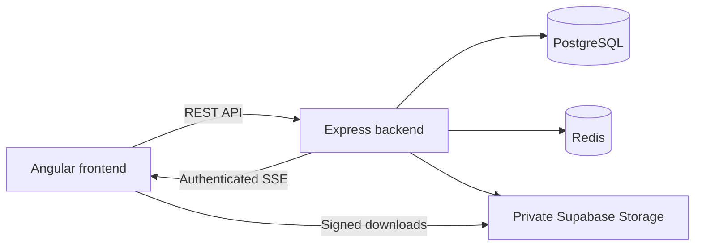

# Support Ticket Dashboard

[**Public API documentation (Postman)**](https://documenter.getpostman.com/view/37614229/2sBYPv2XmA) — interactive API reference with request payloads, response examples, and authentication requirements.

A role-based support ticket management system built to demonstrate full-stack engineering through secure authentication, controlled ticket workflows, real-time conversations, and operational dashboards.

The project models a typical support environment: users submit requests, employees manage assigned tickets, and administrators oversee operations and access control.


## Core features

- **Authentication & account settings** — JWT authentication, rotating refresh tokens, profile management, and password changes.
- **Role-based access control** — database-backed permissions, administrative user management, and resource-level authorization.
- **Ticket management** — ticket creation, assignment, priority management, search, filtering, pagination, and controlled status transitions.
- **Real-time conversations** — authenticated Server-Sent Events (SSE) for live comment updates and reconnection recovery.
- **File attachments** — private object storage, file validation, short-lived signed downloads, and orphan cleanup.
- **Dashboard analytics** — role-scoped ticket statistics computed directly in the database.

## User roles

| Role | Responsibilities |
| --- | --- |
| **Admin** | Oversee all tickets, manage assignments, and administer user roles. |
| **Employee** | View unassigned tickets, self-assign work, manage assigned tickets, and track personal requests. |
| **User** | Submit and track personal tickets, participate in conversations, and upload attachments. |

Ticket access and permitted actions are enforced by the backend, including restrictions based on assignment, ownership, and ticket status.

## Architecture



The backend follows a modular monolith architecture, with feature-oriented modules, shared authorization policies, and transactional business logic. PostgreSQL is the source of truth, Redis manages refresh-token sessions, and Supabase Storage handles file content separately from relational metadata.

## Technology stack

| Layer | Technologies |
| --- | --- |
| Frontend (planned) | Angular, TypeScript |
| Backend | Node.js, Express 5, TypeScript |
| Data & persistence | PostgreSQL 17, Prisma 7, Redis 8 |
| Real-time & storage | SSE, Supabase Storage |
| Validation & observability | Zod, Winston |
| Testing & infrastructure | Vitest, Supertest, Docker Compose |

## Engineering highlights

- **Security:** hashed passwords and refresh tokens, authentication-version checks, resource-scoped authorization, and private file storage.
- **Data integrity:** relational constraints, transactional locking, race-condition safeguards, and storage failure compensation.
- **Performance:** database-level aggregation, indexed queries, deterministic pagination, and push-based comment updates.
- **Maintainability:** feature-based organization, reusable validation and authorization, consistent API contracts, and isolated test infrastructure.

## Repository structure

```text
full-stack-dashboard/
└── backend/     # REST API, database migrations, infrastructure and tests
```

The backend implementation and automated test suites are complete. The Angular frontend is the next implementation phase.

## Getting started

The backend requires Node.js 24 LTS (recommended), npm, and Docker Compose. For environment configuration, database migrations, administrator provisioning, and private storage setup, follow the [backend README](./backend/README.md).

Once configured, start the API from the `backend/` directory:

```bash
npm run dev
```

The default API base URL is `http://localhost:5000/api/v1`.

Run the automated backend test suite after configuring the dedicated test environment:

```bash
npm run test:setup
npm test
```

## Documentation

[**Backend documentation**](./backend/README.md) — detailed architecture, API contracts, database model, security design, setup instructions, automated testing, and deployment considerations.

## Project scope

This portfolio project prioritizes correctness, security, and maintainability over unnecessary infrastructure. The current real-time implementation targets a single backend instance; horizontal scaling would require shared event distribution. Email-based password recovery and frontend Google OAuth integration are outside the current MVP scope.
